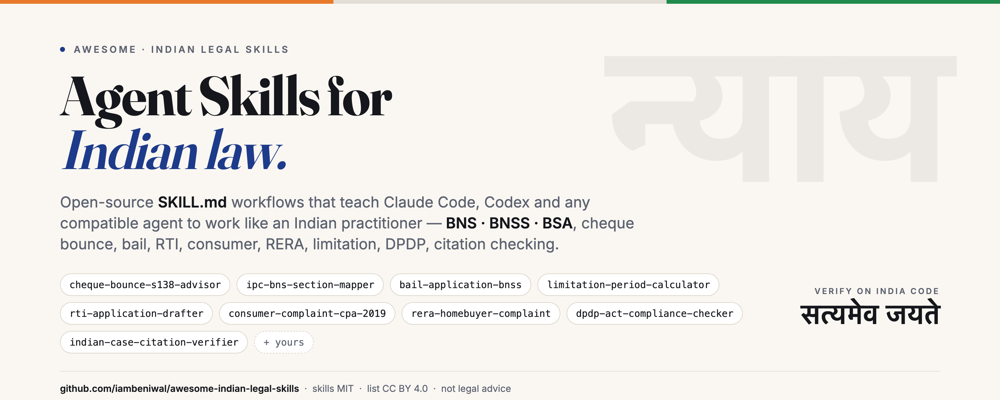

<p align="center">
  <picture>
    <source media="(prefers-color-scheme: dark)" srcset="assets/cover-dark.png">
    
  </picture>
</p>

<p align="center">
  <a href="#table-of-contents"></a>
  <a href="#contributing"></a>
  <a href="#license"></a>
  <a href="#license"></a>
</p>

*A curated collection of open-source **Agent Skills for Indian law** — BNS/BNSS/BSA, cheque bounce, bail, RTI, consumer and RERA complaints, limitation, DPDP, citation checking and more. Written for advocates, in-house counsel, law students and citizens working with Claude Code, Codex and any other agent that reads the open `SKILL.md` standard.*

> [!IMPORTANT]
> **What are Agent Skills?** A skill is a folder with a `SKILL.md` file that packages procedural knowledge for an AI agent: when to act, what to ask for, which official sources to check, how to structure the output, and what not to do. Install one and your agent drafts a section 138 notice, maps an IPC section to the BNS, or audits a consumer complaint the way an experienced practitioner would — with Indian statutes, forums and timelines built in.

> [!WARNING]
> **Not legal advice.** Every skill here is a research and drafting aid. The practice of law in India is reserved to advocates enrolled under the Advocates Act, 1961. A qualified advocate must review every interpretation, citation and draft before it is relied on, sent or filed. Free legal aid is available through [NALSA](https://nalsa.gov.in/) and your District Legal Services Authority.

## Install

**Claude Code** — add the marketplace once, then install any skill by name:

```bash
claude plugin marketplace add iambeniwal/awesome-indian-legal-skills
```

```bash
claude plugin install cheque-bounce-s138-advisor@awesome-indian-legal-skills
```

Or install everything in one plugin:

```bash
claude plugin install indian-legal-skills@awesome-indian-legal-skills
```

**Any other agent** — copy a folder from [`skills/`](skills/) into your agent's skills directory (for example `~/.claude/skills/`, `.codex/skills/` or `.agents/skills/`). Each skill is self-contained.

<!-- INDEX_START -->
# Table of Contents

- [Criminal Law](#criminal-law)
- [Civil Procedure & Limitation](#civil-procedure-limitation)
- [Consumer Protection](#consumer-protection)
- [Real Estate & RERA](#real-estate-rera)
- [Public Law & RTI](#public-law-rti)
- [Data Protection & Technology](#data-protection-technology)
- [Legal Drafting](#legal-drafting)
- [Legal Research & Citations](#legal-research-citations)

## Criminal Law

- 🇮🇳 [bail-application-bnss](<skills/bail-application-bnss>) - Audits a bail matter under the BNSS, 2023 and drafts the application: regular bail (s.480 Magistrate / s.483 Sessions and High Court), anticipatory bail (s.482), default bail when the charge sheet is late (s.187(3)), undertrial release at...
- 🇮🇳 [cheque-bounce-s138-advisor](<skills/cheque-bounce-s138-advisor>) - Audits a dishonoured-cheque matter under section 138 of the Negotiable Instruments Act, 1881 and drafts the statutory demand notice, the complaint, or the reply. Computes every deadline in the chain (presentment, 30-day notice, 15-day...
- 🇮🇳 [ipc-bns-section-mapper](<skills/ipc-bns-section-mapper>) - Maps sections between India's old and new criminal codes — IPC 1860 ↔ Bharatiya Nyaya Sanhita 2023, CrPC 1973 ↔ Bharatiya Nagarik Suraksha Sanhita 2023, Indian Evidence Act 1872 ↔ Bharatiya Sakshya Adhiniyam 2023 — and tells you which code...

## Civil Procedure & Limitation

- 🇮🇳 [limitation-period-calculator](<skills/limitation-period-calculator>) - Works out whether an Indian suit, appeal or application is within time under the Limitation Act, 1963 or the governing special statute, and gives the last date to file. Picks the Article of the Schedule (or the special-law period...

## Consumer Protection

- 🇮🇳 [consumer-complaint-cpa-2019](<skills/consumer-complaint-cpa-2019>) - Audits and drafts complaints before the District, State and National Consumer Commissions under the Consumer Protection Act, 2019, including e-Daakhil filing. Runs the "consumer" test first, picks the forum from the consideration paid (not...

## Real Estate & RERA

- 🇮🇳 [rera-homebuyer-complaint](<skills/rera-homebuyer-complaint>) - Audits and drafts a homebuyer (allottee) complaint under the Real Estate (Regulation and Development) Act, 2016 for delayed possession, refund with interest, defects, false promises or unregistered projects — and the promoter's reply....

## Public Law & RTI

- 🇮🇳 [rti-application-drafter](<skills/rti-application-drafter>) - Drafts Right to Information applications, first appeals and second appeals/complaints under the RTI Act, 2005, and replies to common refusals. Identifies whether the body is a "public authority", turns a vague ask into precise numbered...

## Data Protection & Technology

- 🇮🇳 [dpdp-act-compliance-checker](<skills/dpdp-act-compliance-checker>) - Audits an organisation, product, app or data flow against India's Digital Personal Data Protection Act, 2023 and the DPDP Rules, 2025, and drafts what the audit says is missing — a s.5 consent notice, privacy-notice clauses, a breach...

## Legal Drafting

- 🇮🇳 [legal-notice-drafter-india](<skills/legal-notice-drafter-india>) - Drafts and audits legal notices and replies under Indian practice — demand notices, breach and cease-and-desist letters, and the statutory notices with mandatory periods and contents: s.80 CPC (two months before suing the Government)...

## Legal Research & Citations

- 🇮🇳 [indian-case-citation-verifier](<skills/indian-case-citation-verifier>) - Checks every Indian case citation, statute reference and quotation in a draft before it goes into a filing, opinion or article — does the case exist, is the citation in the right form (INSC and High Court neutral citations, SCC, AIR, SCR...
<!-- INDEX_END -->

## Resources

Other open projects for Indian law and AI that pair well with these skills. Each has its own licence.

### Skills and plugins

- [rohasnagpal/legal-ai-skills](https://github.com/rohasnagpal/legal-ai-skills) — a full "AI law firm" plugin (Managing Partner, specialist lawyers, India/US/UK jurisdiction counsel, 226 skills) with India-specific skills for RERA, s.138 NI Act, GST, DPDP, SARFAESI, FEMA and more. MIT.
- [shashionline/indian-law-plugin](https://github.com/shashionline/indian-law-plugin) — the broadest coverage of the lot: 32 agents, 32 commands, 13 skills and ~235 reference protocols across 11 domains (contract, criminal, corporate, labour, property, IP, constitutional, consumer, cyber, RTI, civil procedure), with useful labour formulas, title-chain tables and a mock-court trainer. Read it as a map of tasks, not as law — much of it predates the 2024 criminal codes and the 2021 consumer rules (BNSS bail numbers, the "531-day" COVID figure, pecuniary limits and the RERA Authority/AO split are wrong as of this review), and several cited protocol files do not exist. MIT.
- [mihirkavi/indian-law-official-sources](https://github.com/mihirkavi/indian-law-official-sources) — official-sources-only research protocol with a 56-entry source registry (access and API status per source, commercial databases and Indian Kanoon excluded), a sandboxed retrieval MCP server that saves originals with SHA-256 and checks quotes verbatim, a source-ledger template, and a Bombay High Court (Nagpur) BNSS s.528 quashing-application drafter that renders .docx. Maharashtra-first; evaluated with pre-registered prompts. MIT.
- [lawve-ai/awesome-legal-skills](https://github.com/lawve-ai/awesome-legal-skills) — the global list this one is modelled on. Its India entries: three DPDP skills (the consent-notice skill by Siddhi Kudalkar tracks the notified 2025 Rules most closely; check rule numbering in the others against the Gazette text) and a FEMA/NDI Rules foreign-investment approval assessment. Per-skill licences (AGPL/Apache).

### Datasets, models and retrieval

- [JitendraJha98/nyaya-model](https://github.com/JitendraJha98/nyaya-model) — open Indian legal guidance system answering in English, Hindi or Hinglish with citations to BNS/BNSS/BSA, with IPC↔BNS bridging, a 413-question benchmark and a CPU-runnable retriever. Apache-2.0.
- [goyashek/bns-legal-rag](https://github.com/goyashek/bns-legal-rag) — retrieval-augmented QA over BNS/BNSS/BSA (1,059 sections) with a deterministic citation validator and published RAGAS results. MIT.
- [sheevu/indian-law-training-dataset-2026](https://github.com/sheevu/indian-law-training-dataset-2026) — an index of Kaggle datasets (a 26,000-path listing of Supreme Court judgment PDFs 1950–2024; landmark-judgment and chain-of-thought sets referenced by path) plus a "Vakeel GPT" persona prompt. The repo itself holds no judgment text or statute data — listed for discovery only. MIT.
- [Awesome-SSP/indian-kanoon-crawler](https://github.com/Awesome-SSP/indian-kanoon-crawler) — hobby Selenium scraper of indiankanoon.org search pages and PDFs. No robots/terms handling, bypasses Indian Kanoon's official API, and the README says MIT while `LICENSE.md` is AGPL-3.0. Listed for awareness, not recommended; cite judgments from sci.gov.in / e-SCR.

### Official sources

- [India Code](https://www.indiacode.gov.in/) — authoritative text of Central and State Acts, with amendment history (`indiacode.nic.in` is the legacy host).
- [e-Gazette of India](https://egazette.gov.in/) — notifications, commencement orders and rules.
- [Supreme Court of India](https://www.sci.gov.in/judgements/) · [e-SCR](https://scr.sci.gov.in/scrsearch/) · [Verdict Finder](https://verdictfinder.sci.gov.in/) — judgments with neutral citations (`YYYY INSC NNN`); e-SCR and most court portals are CAPTCHA-gated.
- [eCourts Services](https://services.ecourts.gov.in/) · [NJDG](https://njdg.ecourts.gov.in/) — case status and judicial data for District Courts and High Courts.
- [e-Daakhil](https://edaakhil.nic.in/) — online filing for consumer commissions.
- [RTI Online](https://rtionline.gov.in/) — Central Government RTI applications and appeals.

## Contributing

Pull requests are welcome. Read [CONTRIBUTING.md](CONTRIBUTING.md) — it covers the folder layout, the frontmatter every skill needs, how to run the validator, and the review bar (India-specific, cites current law, tells the agent which official source to verify against, never claims to be legal advice). Start from [`templates/skill-template/`](templates/skill-template/).

If you would rather not open a PR, use the [Submit a skill](https://github.com/iambeniwal/awesome-indian-legal-skills/issues/new?template=submit-skill.yml) issue form.

## License

- **Skills** (everything under `skills/`) are MIT-licensed unless a skill's own `LICENSE.txt` says otherwise. Each skill folder carries its own licence file and author credit.
- **The list itself** (this README and the index) is licensed under [CC BY 4.0](https://creativecommons.org/licenses/by/4.0/): fork, copy and redistribute it with attribution.

## Acknowledgments

Modelled on [Lawve AI's awesome-legal-skills](https://github.com/lawve-ai/awesome-legal-skills), which showed that a curated list of skills is more useful than a curated list of links. Thanks to the Indian legal-tech builders linked above for publishing their work openly, and to Anthropic for the Agent Skills standard.
